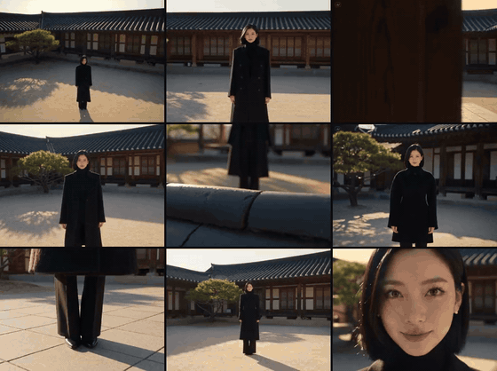

# Short Drama Starter

Free starter rules for making AI short dramas with Claude Code or Codex. Seven rules from a real AI short-drama workflow, packaged as a skill your assistant applies for you.

A dolly-in test on Ohmyo, our AI host. The starter phrase for this move is <code>slow dolly in, ending on a close-up</code> (rule 4). AI-generated.

## What's inside

| Rule | What you get |
|---|---|
| 1. Lock the board before you render | where credits actually go, and what to settle before video |
| 2. A 60-second beat map | five beats with timings for a one-minute drama |
| 3. Write one shot at a time | the four parts of a camera move, with an example |
| 4. Six camera moves to start with | when to use each, with a phrase to paste |
| 5. Keep the face from drifting | what to reference, and what never to feed a video model |
| 6. Build video prompts in a fixed order | the block order that keeps prompts stable |
| 7. Before you press generate | a four-point checklist |

The skill replies in your language and writes model prompts in English. It never generates anything by itself, and it asks you to confirm the cost before any paid generation.

## Install

**Option 1: ask your assistant.** Download this repository as a ZIP, put it in your project folder and tell Claude or Codex: `Unzip this skill here and install it.` Then start a new session.

**Option 2: by hand.** Copy the skill folder into your project:

| Tool | Copy this folder | Into |
|---|---|---|
| Claude Code | `.claude/skills/short-drama-starter` | your project's `.claude/skills/` (or `~/.claude/skills/` for every project) |
| Codex | `.agents/skills/short-drama-starter` | your project's `.agents/skills/` (or `~/.agents/skills/`) |

Start a new session after installing. On a Mac, press Cmd + Shift + . in Finder to see folders that start with a dot.

**Try it:** `Give me a 60-second beat map for a revenge short, then write the first shot.`

## Free starter or full pack?

Start with the free rules. Move up only if you want the whole workflow written out for you.

| | Free starter | Short Drama Prompt Skill |
|---|---|---|
| What it covers | seven starter rules | one-line idea to edited draft |
| Production assets | 7 rules | 106, including 21 step-by-step prompts |
| Camera moves | 6, with a phrase each | 32, each ending still |
| Ready-to-use techniques | none | 100 camera and acting techniques |
| Seedance 2.5 templates | none | included |
| Character and location sheets | none | layouts with examples |
| Edit values and fixes by symptom | none | included |
| Price | free | one-time payment, launch price for the first 30 buyers |

Nine of the 32 camera moves in the full pack, tested on Ohmyo, our AI host. AI-generated.

Both run on your own AI account. Subscriptions and generation credits are separate, and we don't promise views or revenue.

See every file in the full pack before you buy: [ohmyo-studio.pages.dev/en/skill](https://ohmyo-studio.pages.dev/en/skill/?utm_source=github&utm_medium=readme&utm_campaign=starter)

## License

Free for personal use. Share the link to this page instead of re-uploading the files, and don't sell them. Full terms: [LICENSE.txt](LICENSE.txt).

Made by Ohmyo Pictures · ohmyopictures@gmail.com
