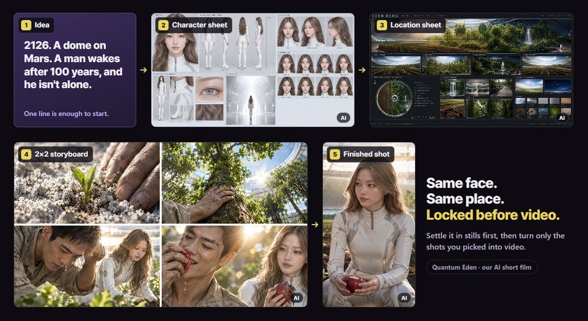
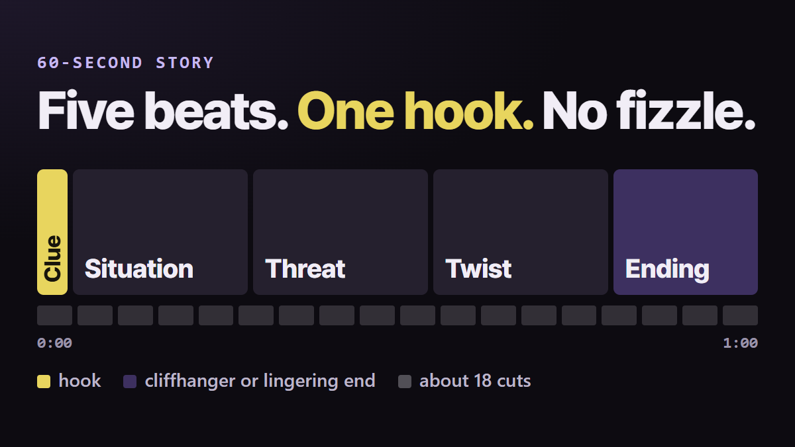
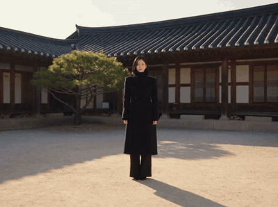

<b>SHORT DRAMA STARTER</b> · a free skill for YouTube short-drama beginners

<h1 align="center">Make your first short drama</h1>

<b>Even if you've never made a video.</b> Seven beginner rules your AI assistant applies for you, from first idea to first shot.

Free · Works in Claude Code &amp; Codex · No film experience needed · Asks before any paid generation

| Face keeps changing? | Place keeps shifting? | Story fizzles out? |
|:---:|:---:|:---:|
| **Keep one face** | **Stills before video** | **Five beats, one minute** |

## The 60-second story

<b>Five beats, one hook.</b> The starter gives you the beat map; sheet layouts and step-by-step prompts come with the full pack.

Frames above are from <i>Quantum Eden</i>, our AI short film. AI-generated.

## Start in 3 steps

1. **Download** this repo (Code → Download ZIP) into your project folder.
2. **Install:** tell Claude Code or Codex `Unzip this skill here and install it.` Then start a new session.
3. **Ask:** `Plan my first short drama.`

Install by hand

| Tool | Copy this folder | Into |
|---|---|---|
| Claude Code | `.claude/skills/short-drama-starter` | your project's `.claude/skills/` (or `~/.claude/skills/` for every project) |
| Codex | `.agents/skills/short-drama-starter` | your project's `.agents/skills/` (or `~/.agents/skills/`) |

Start a new session after installing. On a Mac, press Cmd + Shift + . in Finder to see folders that start with a dot.

## Free starter or full pack?

| | Free starter | Short Drama Prompt Skill |
|---|:---:|:---:|
| Production assets | 7 rules | 106, including 21 step-by-step prompts |
| Story formulas | 1 beat map | 6 |
| Camera and acting techniques | 6 camera moves | 100 |
| Character, location and 2×2 board layouts | none | 3, with examples |
| Price | free | one-time · $19 for the first 30 buyers, then $29 |

Both run on your own AI account. Subscriptions and generation credits are separate. We don't promise views or revenue.

## The 7 starter rules

1. Lock the board before you render
2. A 60-second beat map
3. Write one shot at a time
4. Six camera moves to start with
5. Keep the face from drifting
6. Build video prompts in a fixed order
7. Before you press generate

Rule 4 on Ohmyo, our AI host. AI-generated.

## License

Free for personal use. Share the link to this page instead of re-uploading the files, and don't sell them. Full terms: [LICENSE.txt](LICENSE.txt).

The film frames and the GIF on this page are AI-generated, from our own productions. Not an official product of, or endorsed by, Anthropic, OpenAI or YouTube.

Made by Ohmyo Pictures · ohmyopictures@gmail.com
